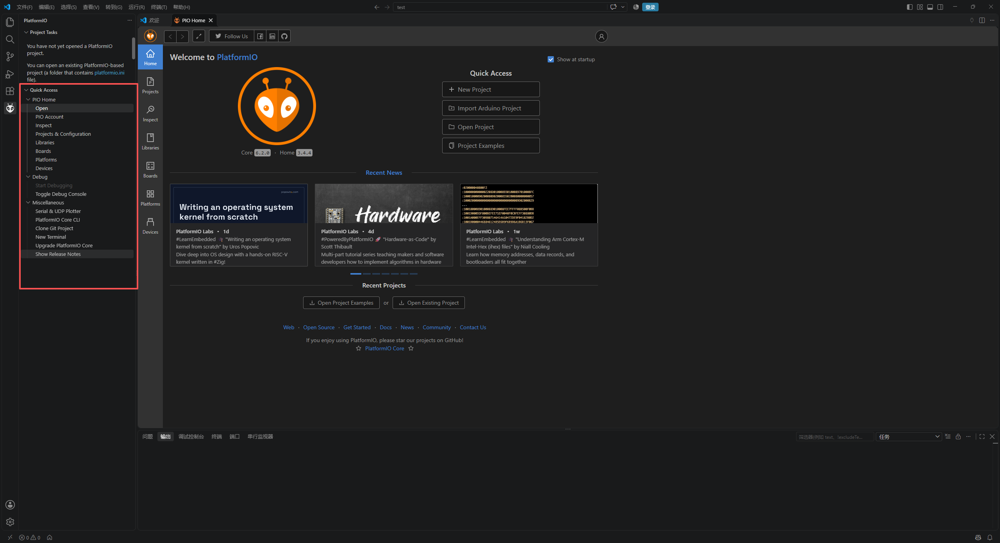
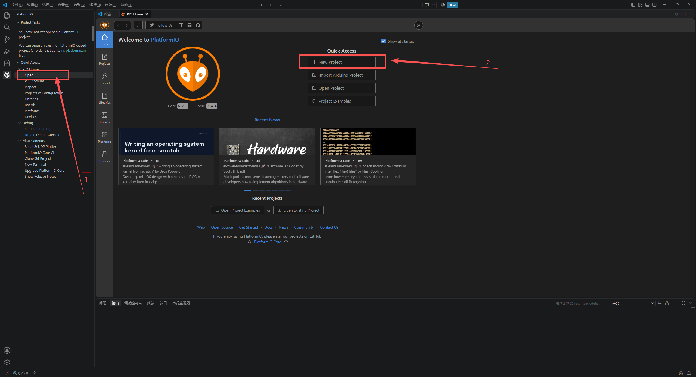
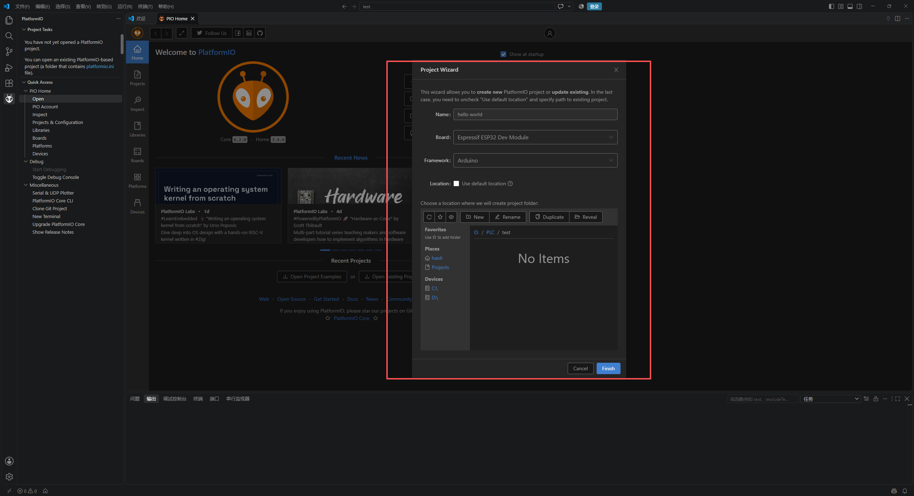
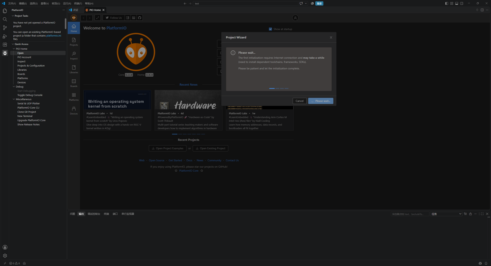
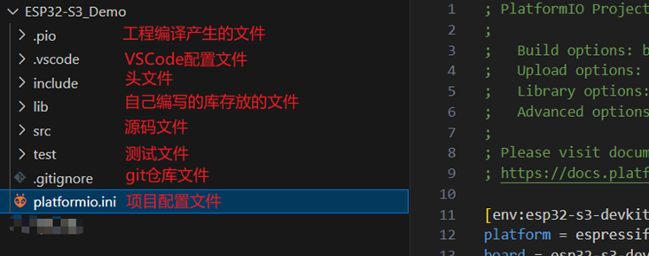
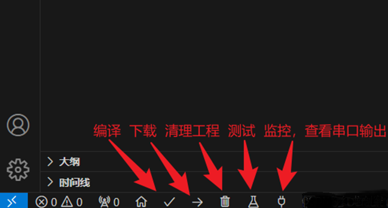
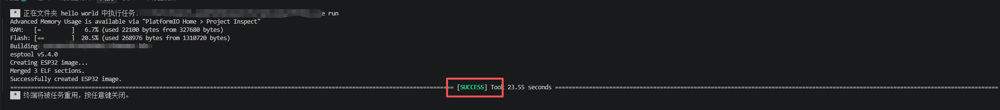
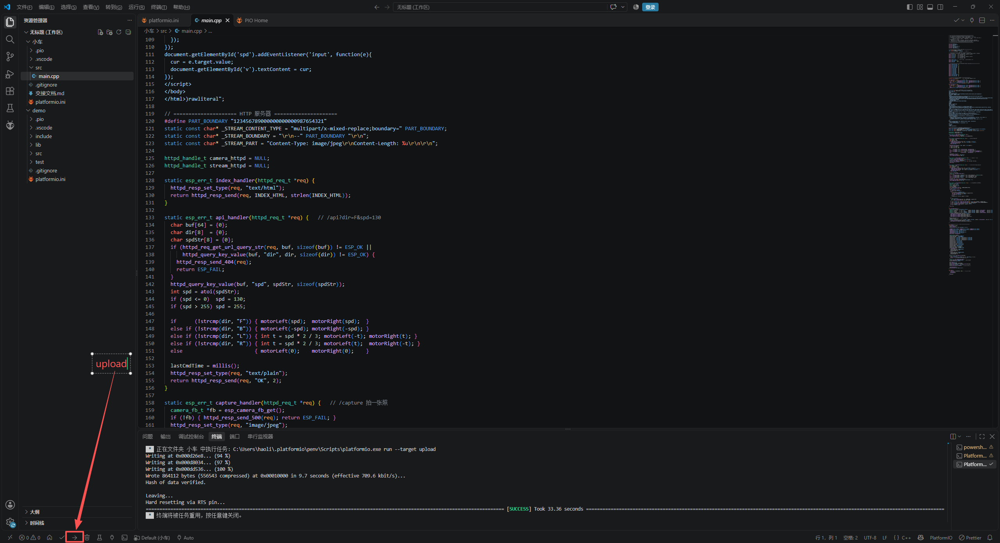
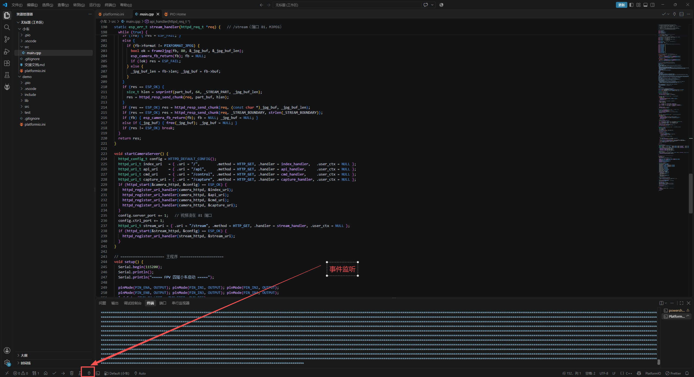

# **一、前置环境准备**

arduino ide安装网址：`arduino.cc/en/software`

但是注意这个ide开发复杂的硬件烧录程序会比较吃力；

我选择用vscode中的`PIO HOME`这个插件（优势是开发复杂硬件烧录程序会比较轻松，可读性也高），注意要在插件商城搜索的名字叫`PlatformlO IDE`（vscode还是太叼了）

建议使用vscode开发的话，最好同时安装以下的插件，开发debug都会更舒服：

```
C/C++
Error lens（报错提醒）
Prettier - Code formatter（代码可读性规范化）
Serial Monitor（串行监视器，用于嵌入式开发/物联网（IoT）的串口调试）
```

然后记得`PlatformlO IDE`这个插件安装好之后会在后台自动下载python库，只有你看到如下图中的open字样的功能区才算安装完成，当然因为python库大部分都是默认国外源的，你可以关掉vscode之后开启vpn的tun模式后再次打开，很快就会下载好，然后所有前置环境准备就都完成了。



# **二、创建一个项目**

我们打开vscode初始化完成的`PlatformlO IDE`插件，如下图顺序依次点击open，new project



然后我们来看一下创建项目的界面，如下图：



name就不解释了

但是**brand**很重要，不能乱写，需要根据你购买的esp32板子型号来填写，`brand型号和你购买的esp32板子型号不匹配会导致后续代码烧录不进去，严重的更可能会烧板子`。这里我填写的是适配性最高的型号`Espressif ESP32 Dev Module`，另外如果你买的是带摄像头或带小屏幕或者支持ai的还有`Espressif ESP32-S3-DevKitC-1`等等，你实在不清楚的话到时候问你采购板子的商家就行，不做多赘述了。

接下来就是**framework**，顾名思义是开发框架，可以理解成软件开发里的开发语言或者开发环境，当然是我个人理解，这里就用默认的`Arduino`，地位类似于语言界的`python`。

然后设置好配置后我们点击finish等待即可，第一次加载比较慢是正常的（我4060的拯救者第一次创建时间超过了15分钟才好）。



经过漫长等待，终于初始化完成，接下来我们进行初始化项目架构的学习，如下图：



后续自己写的一些代码功能基本上都是放在src文件夹中的，这个需要给agent做约束不能自己在其他文件夹拉屎。

而且我们可以看到嵌入式开发很喜欢用`C##`做开发，正好学习的过程中我们也恶补一下c##知识。

然后我们看下图，终端框相关功能按钮布局也是和常规软件开发和web开发不同，不多做赘述。



我们点击√后，就会看到终端开始编译初始化的程序，后续在调试代码debug的时候也要留意终端运行结果，出现`success`字样即表示编译成功，如下图：



# 三、烧录一个项目进入ESP32主板

使用agent将你脑海中的代码都写完后，和**软件/网页开发**类似的一点是想将代码烧录进主板（我理解为上线代码到生产环境）前，需要进行本地测试，当然这个测试很简单，无法测试功能性，只是简单测试代码是否能跑通并且无报错，可以点击`build`按钮本地运行一次，如上图一样终端显示`success`就没问题。


一切没问题就可以将代码烧录进主板，点击左下角的`upload`按钮将代码烧录进主板。



完成后就可以在板子上运行烧录后的代码看是否会有功能性上的问题，我们点击类似插头的图标，这个是运行并监听板子运行程序的日志：



然后看终端就行了，如果点击监听后未出现板子运行的日志信息，则按一下板子上的`reset`按钮即可。

要重启板子，有两种方式：

1、按下esp32主板上的`reset`按钮；

2、断开数据连接线然后重新插上；


# 本人在实操中碰到的**问题**

本人在接板子，进行固件系统热更新的时候发现`OTA 上传`每次上传会卡死，具体表现如下：

• 网页一直“上传中”或显示 Failed to fetch；
• 电脑直接 POST 也被远端断开；
• 串口看不到“OTA 请求到达”；
• 热点消失，需要重新上电恢复。

后面排查后发现原因如下：

ESP32-CAM 原生 HTTP OTA 上传即断线：默认 4KB 任务栈不足，将栈空间从 4096 字节改为 8192 字节即可

# **专业术语学习**

## 1、什么是串口调试？

你写代码如果报错了，ide中会有报错提示，但是嵌入式开发的物件很多没有屏幕，那么报错的话信息在哪里查看呢？没错，需要你用usb调试线一端连接物件一端连接电脑，报错的信息会顺着线传给电脑上的开发ide上，你在使用线连接电脑和物件后进行的debug就叫串口调试。

上面vscode中下载的插件`Serial Monitor`就是一个打通物件和连接电脑的**对讲机**，因为你电脑哪怕用连连接上了物件和电脑也是没办法传输报错信息的，需要**对讲机**。

## 2、如何挑选板子不踩坑（网上经验总结，独立思考明辨是非）？

买前问店家一句话：

a，是焊好的成品吗？（简单理解就是能开箱即用，不用烧录板子，可以直接跳到配网）